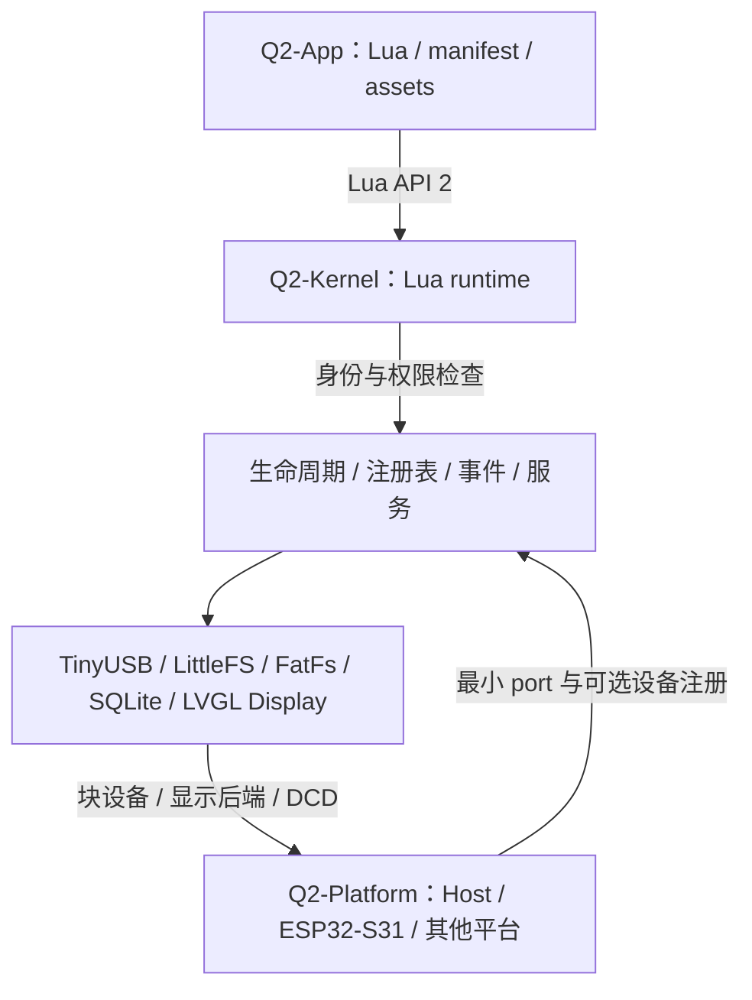

# 架构与边界

## 三个独立开发单元

| 层 | 所有权 | 禁止依赖 |
|---|---|---|
| Q2-App | 页面、业务、配置与资源 | C 指针、SDK、寄存器、任意文件路径 |
| Q2-Kernel | 组件协议、Lua API、权限、通用组件实现 | ESP-IDF、FreeRTOS、板级引脚、具体 APP |
| Q2-Platform | 时钟、中断、线程、DMA、Flash 分区、引脚和外设驱动 | 反向修改 Kernel 才能接入的私有捷径 |

现在 q2 为产品集成 Git 仓库，app、kernel、platform 各为独立 Git 仓库；尚未配置远端或 submodule。根配置和入口通过显式路径组合三者；Platform 独立构建仍显式传入 `Q2_KERNEL_DIR`。APP 工具只需要 Python 标准库。

## 最小内核

核心只必需 `allocate`、`release`、`now_ms`，三者通过 `q2_port_t` 注册。没有强制日志、线程、信号量、显示、网络、存储或启动 APP 的要求。移植者在自己的循环中调用 `q2_kernel_poll()`。

内核是单一 owner/executor 模型：所有 Q2 API、组件及 runtime 回调运行在同一执行上下文。中断和其他线程必须在 SoC 层排队，然后由 owner 转发。`q2_event_post()` 本身不是跨线程队列，不可从 ISR 调用。不得在回调中递归 poll 或销毁内核。

显示可以注册文本 provider，或可选 LVGL provider。后者由 Kernel 管理控件、输入、渲染和 Lua 事件，SoC 只提供同步像素矩形输出以及 owner 上的输入转交；详见 [LVGL Display](../kernel/docs/lvgl-display.md)。Windows 原生窗口和 Linux SDL2 窗口位于独立 platform/x86，公共接口不包含窗口系统/LVGL 内部类型。

组件注册在 boot 前完成，描述符及其引用的字符串、方法表、服务表必须保持有效直到内核销毁。boot 先验证完整依赖图，再按拓扑顺序启动。重复 ID、服务和 Lua 方法会被拒绝；注册后不能热替换组件。

`needs` 是必须存在且 READY 的依赖；`after` 仅要求已有组件先启动，不强制存在或成功。可选组件失败后其他独立组件仍可运行；必需组件失败使 boot 返回错误，由产品层决定进入恢复模式还是销毁。不要忽略返回值。组件 poll 出错会向调用者报告，但当前不会自动重启或更改 READY 状态。

## Runtime 与权限

Core 通过 `q2_runtime_driver_t` 接 runtime，不包含 Lua 头文件。Lua runtime 使用通用方法表建立 `require('q2')` 对象；新增普通组件无需修改 Lua 绑定器。

API 2 支持最多 8 个独立 Lua VM，在同一 owner 线程协作运行；产品有一个常驻生命周期 Home 和一个可见前台。每次 poll 分别推进存活 VM 的 on_tick(now_ms)，后台业务可继续。每次启动分配不复用的 instance，旧 instance 的事件不会交给新 APP。UUID 是应用持久身份，instance 是一次运行的资源所有权；两者不能混用。

权限由“manifest 声明 ∩ 产品授权 ∩ READY 能力”决定。required 不满足就拒绝启动；optional 不满足允许启动，但调用返回错误。Lua 参数不能指定自己的 caller、grant 或存储 UUID。内核中的 C 组件和调用者属于可信代码，不把这层接口当作 MPU 隔离或恶意原生插件沙箱。

退出先关闭 VM，再按逆依赖顺序释放该 instance 的资源。失败保留清理状态，可重试；成功清理后才能重新启动。管理模式先 apps_shutdown 回收 manager-owned 普通 VM，再销毁 caller-owned Home runtime → kernel → 组件对象 → 设备后端。当前没有 Lua `on_stop` 回调，关键资源回收必须由 C 组件完成。

## 资源边界

最多 24 个组件、32 个事件、每组件 4 个硬依赖及 4 个顺序依赖。满队列返回 `Q2_ERR_LIMIT`，状态接口记录丢弃次数。每次 poll 的事件预算最多 32。

Lua VM 限额 32–384 KiB，包含分配头和重新分配时的瞬时双份内存；源文件最多 32 KiB、manifest 最多 4 KiB。Lua 指令 hook 每 1000 条检查，单次回调约 100000 条指令或 30 ms Lua 执行时间预算；启动标准库准备/有界源码编译不计入，注册组件调用及日志后端耗时排除，但不恢复已消耗的时间/指令。该时间不是硬实时保证，不能抢占 C 回调、编译器或垃圾回收。组件操作必须有界，耗时 I/O 应在 SoC 异步完成后发事件。

内核和 Lua VM 使用 port 分配器；组件对象、cJSON 及部分第三方库仍使用标准 C 堆。SoC 需提供标准 C 运行库，Lua 配额不等于全系统内存上限。当前不支持多个并行 Kernel 实例共享 SQLite、FatFs 或 TinyUSB 全局状态。

## 可选应用管理

[apps 组件](../kernel/docs/application-manager.md)提供可信出厂目录、前台切换、多 VM 与共享背景；Homepage 是常驻 lifecycle Lua APP。SoC owner 在 poll 返回后推进导航，只在目标需新启动时准备其资源；其他 VM 和隔离场景保留。锁屏/状态栏/屏保策略由 Home 实现，Kernel 强制层级与身份权限。

input/keys 是可选的命名按键 provider：注册与订阅走组件契约，传递已经识别的单击/双击/长按；不识别时序、不指定功能。见 [keys](../kernel/docs/keys.md)。

## 产品集成层

q2 根目录拥有 q2.json、构建/启动脚本、公共文档和 AI 指南。配置校验器生成 build/<target>/generated/ 下的 C 头文件和 CMake 选项；Platform 显式消费生成目录，Kernel 仅接收公开构建选项和注册调用，不读取产品 JSON。

根仓库忽略三个子仓库目录，避免将独立仓库误当普通目录或生成不可克隆的隐式 gitlink。当前没有远端 URL，获取工作区需要分别提供三个 checkout；配置 repositories 可指向其他绝对或相对路径。

## 通用状态与事件

可选 data 组件以固定类型的注册表连接 provider 与 APP；Core 不枚举设备字段。缓存状态可 get/订阅，离散事件逐次投递，数据项自带领域权限、单位及失效语义。Platform owner 发布，Runtime 将有界 typed event 映射为 Lua。按键仍经过 resident 路由，普通数据订阅不能绕过锁屏。详见 [设备数据](device-data.md)。
