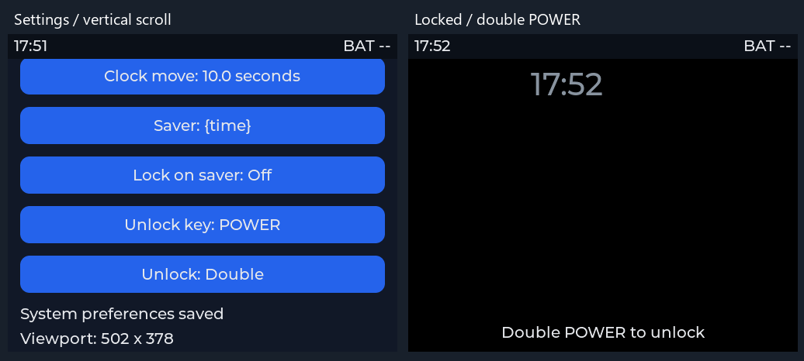

# Lifecycle 与多 Lua VM 验证

日期：2026-10-09。Windows x86 / Zig 0.13 / 固定 Lua 与 LVGL 9.3 源码；产品默认 502×410、32 px 状态栏。构建在 root build/lifecycle，测试只用临时包、临时介质和测试进程，没有改动用户的持久介质或接管运行中的窗口。

## 已执行

- x86 CMake/Ninja 构建；CTest **8/8**：产品配置、按键识别、日志、LVGL、原生兼容 system_ui、应用管理、多 runtime、keys。
- 独立 Kernel UBSan / Werror：**159** 项，真实 Lua/LittleFS/FatFs/SQLite/TinyUSB（USB 使用 fake DCD）。
- APP 工具：**76** 项；契约清单：30 portable files、77 C APIs、45 component methods、1274 vendor hashes。
- test_homepage_ui.py / test_settings_ui.py：真实导航与背景持久化，采用新的滚动设置页坐标。
- test_lifecycle_ui.py：实际多 VM/显示/Web 输入集成，见下表。
- ESP32-S31 最小工程交叉编译：ESP-IDF v6.2-dev、riscv32-esp-elf 16.1.0；不启用尚未实现的显示/设备 provider，不烧录。

| 行为 | 验证方式 |
|---|---|
| Home 常驻 | 打开/退出 Settings，Home started 日志仅一次，返回为 resumed |
| 真实独立后台 VM | Home + UI Demo + Settings 三实例；隐藏 UI Demo 持续 tick 并改自己的标签 |
| 容量/隔离 | C 测试 8 个 runtime 与第 9 个 LIMIT、定向事件、独立 Lua 全局、单 APP 故障后其他 tick |
| 普通 APP 无系统权限 | 即使 manifest/grants 声明，普通 UUID 无权选择 status 层或修改系统偏好 |
| 滚动/状态栏 | 实际滚轮捕获不同设置行，状态栏保持顶部，关闭/重启/恢复状态栏 |
| 多尺寸 | 502×410、410×502、320×320、64×64 启动成功 |
| 锁屏 | 临时设置 1 秒超时；PLAY 单击、POWER 单击不传给前台 |
| 解锁 | Web down/up 经过 x86 识别双击 POWER，解锁且不触发 APP 事件 |
| 歌词续期机制 | 前台持续 keep_awake 超过超时时间仍清醒；停止续期后再次锁屏 |
| 后台不能抑制锁屏 | APP 返回 Home 后继续 tick，但 keep_awake 拒绝，Home 正常超时 |
| 配置迁移 | 已保存 POWER 解锁，换成仅 BACK 的 registry 后，锁屏自动禁用 |
| 错误分类 | APP 失败后出现同码 provider 故障仍正确返回，不能被旧 APP 错误掩盖 |

## 复现

在 q2 根目录（编译器及 CMake/Ninja 已可用）：

```sh
python q2.py build --build-dir build/lifecycle --compiler zig
ctest --test-dir build/lifecycle --output-on-failure
python app/scripts/test_apps.py
python app/scripts/test_lifecycle_ui.py --runner build/lifecycle/bin/q2_x86.exe --artifacts build/lifecycle/artifacts
python kernel/scripts/check_contracts.py
python kernel/scripts/build.py --cc zig
```

截图来自真实 LVGL framebuffer：



## 边界

并发为单 owner 协作执行，不是抢占式任务或 8 个线程。UI 用当前 PC 的 16 MiB LVGL 池与 64 图片槽；嵌入式必须另做内存预算。API 2 为向后兼容的 Lua 方法增量；C 结构增加状态字段，所有第一方调用者同步重编译，不承诺与旧预编译库二进制兼容。

尚无实体屏幕/按键/电池/无线验证，PC 电量显示 BAT --。屏保锁屏只防误触，不是密码认证或硬件省电。MP3/歌词示例只提供前台续期 API，音频播放、网络下载、APP 安装及 OTA 未在本次实现。
