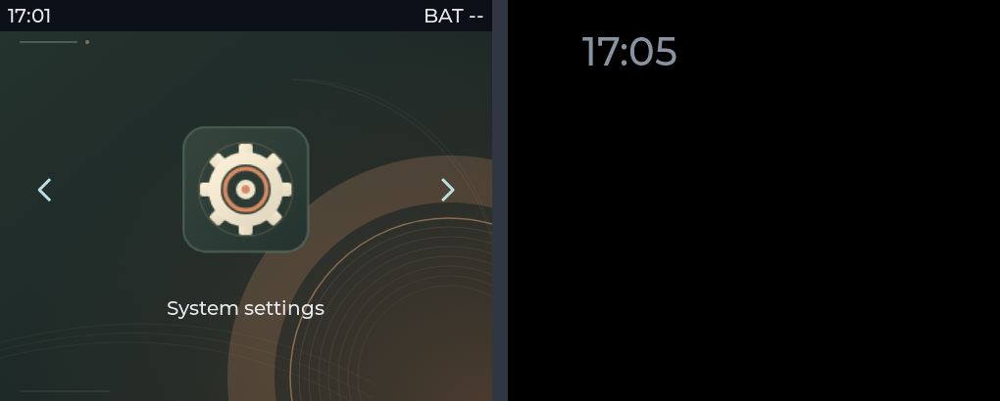

# 状态栏与屏保验证（2026-10-09）

> 此为早期版本验证记录；当前常驻多 VM / Lua 屏保行为见 [Lifecycle 验证](lifecycle.md)。

Windows x64 / Zig 0.13.0 / CMake 4.0.3 / Ninja 1.12.1；使用产品 q2.json 的 502×410、32 像素状态栏、30 秒空闲、10 秒移动配置。

原 build/x86/bin/q2_x86.exe 被既有模拟器占用，因此验证使用独立 **build/system-ui** 目录，没有关闭用户窗口或覆盖其持久存储。所有下列命令从 q2 根目录执行，构建命令中的工具应指定实际安装路径。

```sh
python q2.py build --build-dir build/system-ui --compiler <zig.exe> --cmake <cmake.exe> --ninja <ninja.exe>
ctest --test-dir build/system-ui --output-on-failure
python kernel/scripts/check_contracts.py
python app/scripts/test_apps.py
python app/scripts/test_homepage_ui.py --runner build/system-ui/bin/q2_x86.exe --status-bar-height 32
python app/scripts/test_settings_ui.py --runner build/system-ui/bin/q2_x86.exe --status-bar-height 32
python platform/x86/test_web.py --runner build/system-ui/bin/q2_x86.exe --app-root app
python platform/x86/test_system_ui.py --runner build/system-ui/bin/q2_x86.exe --app-root app
```

实际结果：

- 7/7 CTest 通过：产品配置、按键时序、日志、LVGL、系统 UI、APP 管理、keys 契约。
- 架构/来源检查通过：30 个 portable 文件、69 个带注释公开 API、33 个组件方法、1274 个上游文件校验。
- Q2-App 76 项检查通过；真实 Lua/Home/设置页面点击、背景持久化、切换和错误回退通过；测试使用临时媒体。
- 系统 UI 假时钟测试验证 29999/30000 ms 边界、APP 可用尺寸、触摸首次唤醒不点击穿透、第二次点击送达、持续按住不进入屏保、运行实例不改变、清屏/退出不删除系统层。
- 时钟连续 20 次移动检查每个非黑像素均在边界内、像素数量不变；320×64 短屏也经过连续移动检查，避免短屏高度减法下溢及居中锚点导致偏移出界。
- Web 实际时钟测试等待三次 30 秒空闲，验证 SINGLE/DOUBLE/LONG 唤醒均不增加 reports、不改变 APP 状态；后续独立按键每次只发送一个 SINGLE，Lua 计数连续为 1/2/3。
- 原 Web 按键/协议回归通过，仍无网页屏幕或触摸端点。

下图均来自真实 LVGL framebuffer；右侧为超过 40 秒后的屏保时钟，已经完成一次移动。



APP 使用内容区 502×378。时间由 Windows 提供；BAT -- 是未知电量，并无电池/无线硬件数据。屏保不会关闭屏幕供电或暂停 runtime。本次没有验证 ESP 实物显示、GPIO、功耗或电池接口，也没有提交 Git。
