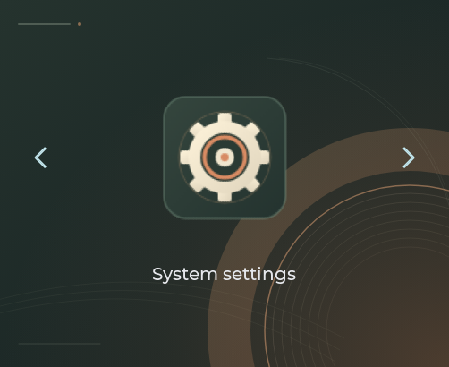
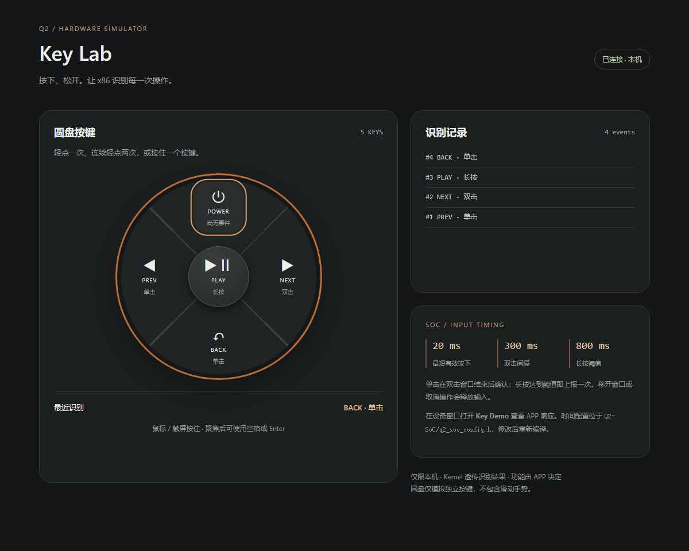

# PC 运行环境

Windows 使用原生窗口，Linux 使用 SDL2；Linux 命令及能力范围见 [Linux SDL2](linux-x86.md)。
下面的 PowerShell 示例用于 Windows。

在同一个 Q2-Kernel/Lua/LVGL 上运行真实窗口。操作入口已移动到 q2 根目录，Platform 只保存后端实现。

```powershell
./run.ps1
./run.ps1 -AppName settings
./run.ps1 -AppName key-demo
./run.ps1 -Headless -Frames 30 -Capture build/home.bmp
./run.ps1 -SingleApp -AppName device-info -DisableWeb
```

依赖为 Python、CMake、Ninja 和 C11 编译器；缺少 PATH 项时用 -Python、-CMake、-Compiler、-Ninja。例如 `-Compiler C:/tools/zig/zig.exe`。新目录使用 root build/x86，旧缓存不可重用。

分辨率、日志、按键判定、Web 端口与组件开关都在 [q2.json](../q2.json)，详见 [配置](configuration.md)。不再向旧 platform/x86/run.ps1 传 Width/Height 等产品参数。直接执行 exe 仍保留 --width/--height 等临时调试参数。

默认启动 Homepage；左右箭头切换单图标，中央进入 APP，Home/Esc 返回。-SingleApp 时 Esc 退出。窗口内鼠标供 LVGL 控件输入；Web 模拟独立按键及电池/Wi-Fi/BLE 数据，不浏览屏幕或模拟触摸。Hardware Lab 默认 http://127.0.0.1:8765/。

状态栏与 30 秒屏保默认启用；锁屏默认关闭，首次触摸/按键/Esc 仅唤醒。Settings 可启用锁屏，默认双击 POWER 解锁且不传给 APP。Home 常驻，普通 APP 各有独立 VM。Settings 为纵向滚动列表，支持滚轮/拖动及 PREV/NEXT。状态栏电量显示 BAT --（未接电池后端）。配置见 [系统 UI](system-ui.md)。

默认持久介质为 build/x86/app-data.lfs（256 KiB）。只有新文件会初始化，已有损坏文件不会自动格式化，同时打开会被独占锁拒绝。原 platform/build/x86/app-data.lfs 不自动迁移；可在关闭旧程序后用 `python q2.py run --storage-file <原文件>` 显式复用。

root dist/ 保存产品开发包与 .run 目录，APP 工具自身的独立 dist/ 不受影响。APP 打包不自动获取权限，仍受 manifest、产品 grants 和可用组件约束。Windows 已接入音频/网络；Linux 已接入网络但暂未移植音频，真实无线连接控制均未实现。

验证命令（在 q2 根目录）：

```sh
python q2.py test --compiler zig
python app/scripts/test_lifecycle_ui.py --runner build/x86/bin/q2_x86.exe --artifacts build/lifecycle-ui
python platform/x86/test_web.py --runner build/x86/bin/q2_x86.exe --app-root app
python app/scripts/test_homepage_ui.py --runner build/x86/bin/q2_x86.exe --status-bar-height 32
python app/scripts/test_settings_ui.py --runner build/x86/bin/q2_x86.exe --status-bar-height 32
```





帧缓冲捕获是实际 LVGL 输出，不是 Windows 桌面截图。PC 验证不代表 ESP 屏幕、GPIO、USB 或物理按键验证。

网络通过当前电脑的已有连接提供，Windows 使用 WinHTTP、Linux 使用 libcurl 异步工作线程。[Network Test 使用方式](../app/docs/network-test.md)：`./run.ps1 -AppName network-test`。
